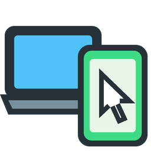

# DroidLeap



Move your mouse pointer off an edge of your desktop and it carries on onto your
Android phone or tablet, as if it were another monitor. Your keyboard follows.
Move back through the device's edge, or press the return key (**Pause** by
default), to return.

The PC presents itself to the device as a USB mouse and keyboard (Android Open
Accessory HID), so it needs no driver, root or screen mirroring. A small
companion app on the device reports when its pointer reaches the edge facing
the PC, over the local network.

## Requirements

- **Linux:** a Wayland desktop with the InputCapture portal (GNOME 46 or later),
  Ubuntu 24.04 or later for the `.deb`. The tray icon needs the AppIndicator
  extension on GNOME (enabled by default on Ubuntu).
- **Windows:** Windows 10 or 11, x64.
- **Android device:** Android 11 or later, connected by USB, with USB debugging
  enabled. Close adb (`adb kill-server`), Android Studio and scrcpy while
  DroidLeap runs: they compete for the same USB interface.
- PC and device on the same network, for returning through the device's edge.
  Without it, the return key still brings the mouse back.

## Setup

Download the files from the [latest release](../../releases/latest).

1. Install the desktop app: the `.deb` on Linux, or run the `.exe` on
   Windows. It lives in the system tray. The `.exe` isn't code-signed yet, so
   Windows warns on first launch: choose **More info > Run anyway**.
2. Install the Android app with [Obtainium](https://github.com/ImranR98/Obtainium):
   add the app with the URL `https://github.com/ssk101/DroidLeap`, and it keeps
   DroidLeap updated from these releases. Or install the `.apk` directly.
   Then turn DroidLeap on under **Settings > Accessibility**. It only draws a
   thin strip along one screen edge; it doesn't read screen content.
   If the switch is greyed out, open **Settings > Apps > DroidLeap**, tap **⋮**
   and choose **Allow restricted settings**.
3. In the tray menu, pick the screen edge the device sits beyond.

| Action | How |
| --- | --- |
| Move to the device | Push the pointer through the chosen desktop edge |
| Come back | Move through the device's opposite edge, or press the return key (**Pause**) |
| Pause the whole thing | Tray menu > **Enabled** |

On Linux, GNOME asks once for permission to capture input. On Windows, the
firewall may ask once about network access; allow it for the Android app to be found.

## Settings

The tray menu changes the common settings; the rest are in the settings file
(tray menu > **Edit settings file**, then **Reload settings**).

| Key | Default | Meaning |
| --- | --- | --- |
| `side` | `left` | Desktop edge that leads to the Android device: `left`, `right`, `top` or `bottom` |
| `threshold_px` | `0` | How far to push through the edge before switching, in pixels; 0 switches on touch |
| `timeout_ms` | `1000` | Time window in which the push must add up |
| `serial` | *(empty)* | USB serial number of the Android device; only needed with several plugged in |
| `return_key` | `pause` | Key that brings input back: `pause`, `scrolllock`, `printscreen`, `insert`, `menu`, `f1` to `f24`, `rightctrl`, `rightalt`, `rightmeta` or `rightshift`. It never reaches the device. |
| `enabled` | `true` | `false` keeps all input on the desktop |

| | Settings file | Log |
| --- | --- | --- |
| Linux | `~/.config/droidleap/config.toml` | `~/.local/state/droidleap/droidleap.log` |
| Windows | `%APPDATA%\ssk101\droidleap\config\config.toml` | `%LOCALAPPDATA%\ssk101\droidleap\data\droidleap.log` |

## Privacy and security

Mouse and keyboard input only travels over the USB cable. The network link to
the Android app carries edge positions only, and is not authenticated yet:
another device on your network could make the mouse return to the PC early.

## Building

The desktop app is Rust (`desktop/`), the Android app Kotlin (`android/`).

```sh
cd desktop
cargo test
cargo build --release          # Linux or Windows, on that OS
./package-deb.sh               # Linux .deb in target/debian/

# Windows build from Linux, with Zig as the linker:
cargo zigbuild --release --target x86_64-pc-windows-gnu

cd ../android
./gradlew assembleDebug        # APK in app/build/outputs/apk/debug/
```

GitHub Actions builds the Windows exe, the Linux `.deb` and the APK for every
pull request merged into `master`; they're attached to the workflow run.

## License

[MIT](LICENSE). The USB HID report descriptors come from
[scrcpy](https://github.com/Genymobile/scrcpy) (Apache License 2.0).
